# drawio-optimize

**生成、优化、最小化修复并 DRC 检查「可编辑」的 Draw.io 工程架构图。**

面向 RTL/SoC 框图、CPU/Datapath、软件架构与 API 流程等工程图：自动完成分层布局、端口分配、正交布线、冲突检测与局部修复，并且**只动几何、不动拓扑**。输出是真正的 `.drawio` 源文件 + PNG/SVG 预览 + 机器可读的 DRC 报告。

> An agent skill + CLI for generating, routing, DRC-checking and minimally repairing editable Draw.io engineering diagrams without changing topology or semantics.

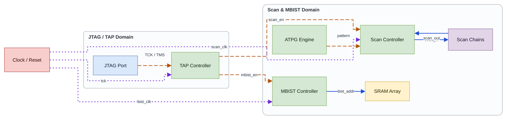

*上图由 `assets/templates/soc_dft.yaml` 生成：LR 主流程、两个容器、控制/数据/时钟三类线型、正交布线，全程 0 error。*

---

## 1. 它解决什么问题

手工维护 draw.io 工程图久了，几乎必然出现这些缺陷：

| 症状 | 根因 | 示例 |
|---|---|---|
| 箭头贴着框边「滑行」、指向错误 | 最后一段没有垂直进入节点边，draw.io 把折线裁到边框上 | ③ |
| 连线穿过无关模块 | 没有把节点当障碍物 | ④ |
| 标签被线压住 / 压在别的模块上 | 标签位置没有参与避让 | ⑤ |
| 一串平行线挤成 10 px 间距 | 没有 bus lane 概念 | ⑥ |
| 箭头前有个小 U 型回头钩 | 最后一个拐点离目标太近，留不出箭头长度 | ⑦ |
| 连线绕大圈、多余折点 | 端点锚点与入线通道没对齐 | ⑧ |

一张 500+ 节点的手工图靠肉眼修这些是不现实的。本工具把**诊断（人工/Agent）→ 修复（脚本）→ 验证（真实渲染）**拆开，每一处改动都有 before/after 记录。

---

## 2. 核心特性

- **从规格生成**：YAML/JSON spec（`nodes` / `edges` / `groups` / `direction`）或简单自然语言 → 完整图。
- **分层布局**：环破除 → 分层 → 长边虚拟节点 → 重心排序 + 转置 → 坐标压缩 → 链拉直，支持容器递归。
- **端口分配**：按流向选边，按邻居位置排序，贪心「直连吸附」让对齐的端点变成一个直段。
- **正交布线**：直连/单折优先，失败后走 Hanan 网格 A*（转角、交叉、重叠、间距加权），再做 rip-up、微折点清理。
- **33 条 DRC 规则**：`R01–R14` 布线、`P01–P10` 布局/端口、`L01–L07` 标签、`S01–S02` 结构。
- **最小修复模式**（`--repair-only`）：专为大规模手工图设计，只修连线端点/锚点/标签/长 bus 间距，功能节点几何**绝不移动**，越界即整批回滚。
- **真实渲染验证**：装了 draw.io CLI 时导出 SVG，按 `data-cell-id` 逐条解析路径，比对起点/终点/折弯数/是否正交，**渲染后的路径再跑一遍 DRC**。
- **格式兼容**：压缩页、`<UserObject>`/`<object>` 包装（tooltip / data-source / 链接）、未知 cell、图片、多页、未知样式键全部原样保留。
- **可编辑**：输出是原生 mxGraph XML，不是图片、不是截图。

---

## 3. 快速开始

### 环境要求

| 依赖 | 作用 | 缺失时 |
|---|---|---|
| Python ≥ 3.9 | 全部功能 | 必需 |
| PyYAML | 读取 YAML spec | 可用 JSON 代替 |
| Pillow + CJK 字体 | 真实文本度量（中文宽度） | 退化为字符估算，报告中标注 `heuristic` |
| draw.io CLI | 独立渲染 + 渲染后路径 DRC | 降级为内置预览，报告明确标注 |

先自检：

```bash
python3 scripts/doctor.py
```

```
skill_version      1.3.0
drawio             /usr/bin/drawio
pillow             9.0.1
text_backend       pillow:DejaVuSans+NotoSansCJK-Regular
features           {'independent_render': True, 'rendered_path_drc': True, ...}
```

### 三种典型用法

```bash
# 1) 从 spec 生成
python3 scripts/generate.py --spec assets/templates/soc_dft.yaml --out-dir out/soc-dft

# 2) 优化/修复已有图（默认 preserve：不动节点位置）
python3 scripts/optimize.py --input architecture.drawio --out-dir out/repair --layout preserve

# 3) 大规模手工图的最小修复（推荐用于 500+ 节点图）
python3 scripts/optimize.py --input atlas.drawio --layout preserve --repair-only --out-dir atlas-fixed/
```

脚本自带 `sys.path` 引导，**可以在任意目录下用绝对路径调用**。

### 产物

| 文件 | 内容 |
|---|---|
| `diagram.drawio` | 可编辑源文件（唯一真实来源） |
| `diagram.png` | 预览（draw.io 导出，否则内置渲染） |
| `diagram.svg` | 矢量预览 / 渲染验证输入 |
| `drc-report.json` | 指标、规则命中、每处修复、未解决项、限制 |
| `drc-report.md` | 同上的人类可读版 |

先看 `drc-report.json` 的 `summary` 判断自动检查是否通过，再看 `drc.unfixed_violations` 看真正没解决的项。

---

## 4. 效果图

下面每张 after 都是 `optimize` / `generate` 的**真实产出**，不是手工拼的示意图；数字来自同一次运行写出的 `drc-report.json`。

### 生成与布局

**① 一份 YAML → 一张图**

```yaml
direction: LR
nodes:
  - {id: client, label: Client,      kind: external}
  - {id: gw,     label: API Gateway, kind: interface}
  - {id: order,  label: Order Service, kind: controller}
edges:
  - {from: client, to: gw, label: request}
  - {from: gw, to: order, label: create, signal: data}
```

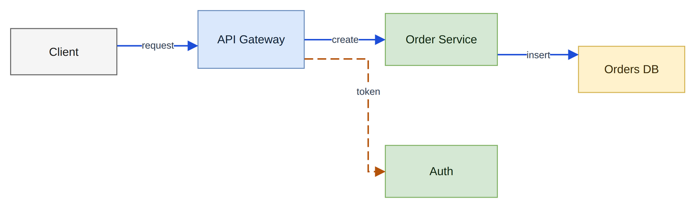

*完整 spec 见 `assets/examples/micro_pipeline.yaml`；节点按 `kind` 取色，边按 `signal` 取线型，容器、端口和正交路径全部自动生成。*

**② 同一份 spec，四种方向**

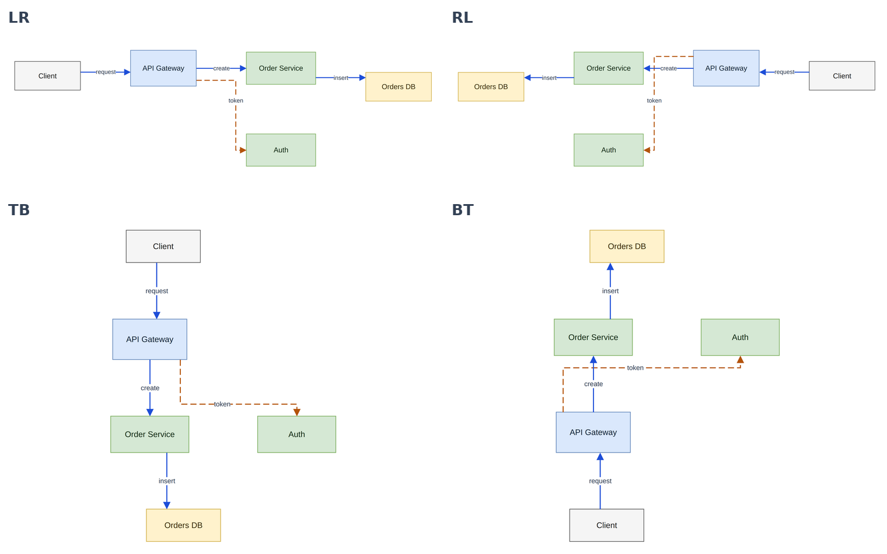

*`--direction LR / RL / TB / BT`：分层、端口朝向、线型回退（反向边翻转）都跟着方向走，不需要改 spec。*

### 连线修复

**③ 箭头贴边滑行、指向错误 — R12**

| before | after |
|---|---|
| 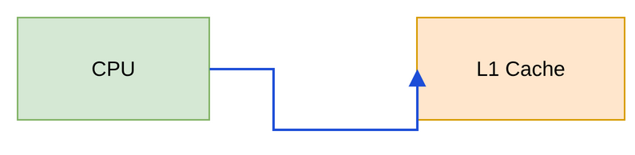 | 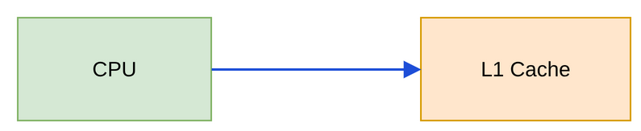 |

`01-terminal-sideways.drawio`：3 findings（含 1 个 R12 error）→ 0。连线沿着目标框左边向上滑、箭头指向边框，是 draw.io 最常见的错误画法。

**④ 连线穿过无关模块 — R02**

| before | after |
|---|---|
| 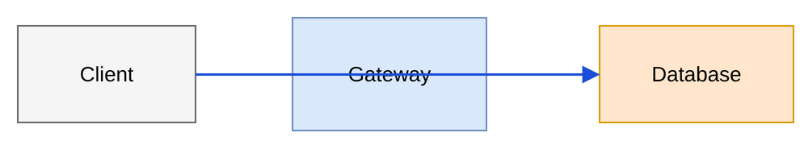 | 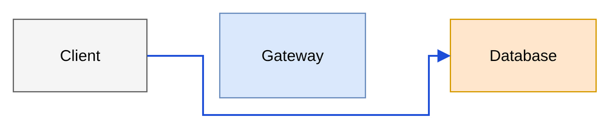 |

`02-wire-through-module.drawio`：R02 error + L01 error（线压在 Gateway 文字上）→ 两者清零，仅余 1 条 P02 提示。

**⑤ 标签被拖到别的模块上 — L07 / L02**

| before | after |
|---|---|
| 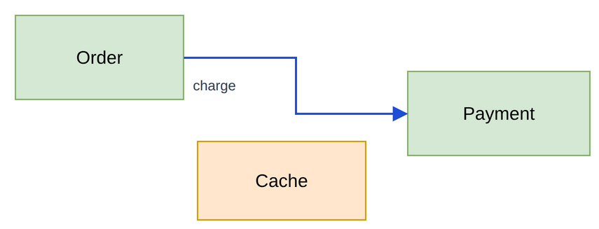 | 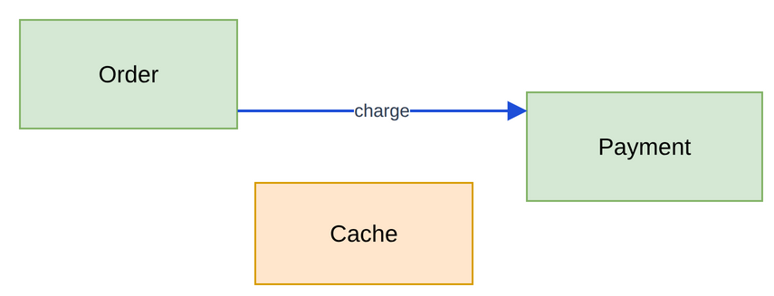 |

`03-label-on-module.drawio`：3 findings（L02 error、L07 warning、R01 warning）→ 0。标签回到自己的连线上。

**⑥ 并行线挤成 8 px — R13**

| before | after |
|---|---|
| 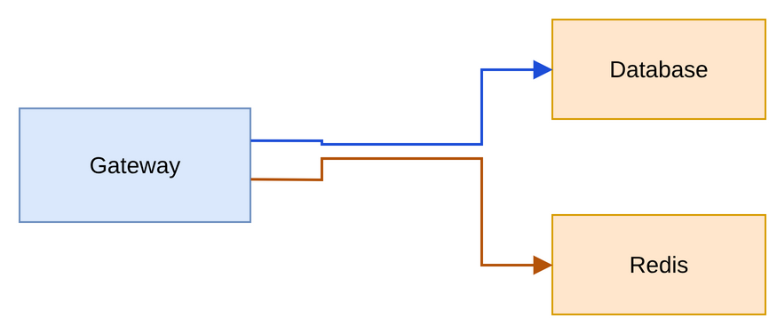 | 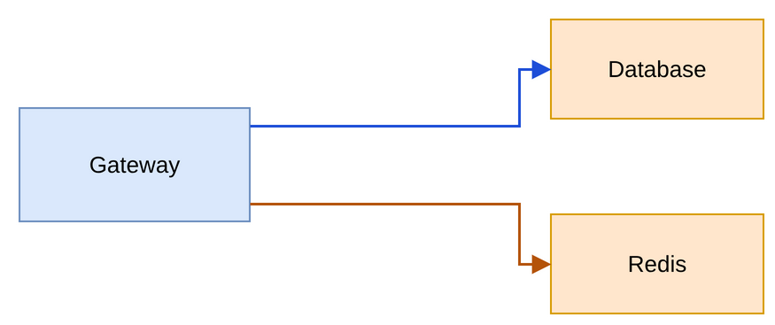 |

`04-dense-parallel.drawio`：R13 ×2（8 px 间距、90 px 长）→ 清零，改为各自独立的通道；残余 2 条 R01 提示（末端 20 px 台阶）。

**⑦ 箭头前的 U 型回头钩 — R14**

| before | after |
|---|---|
| 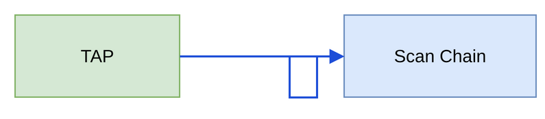 | 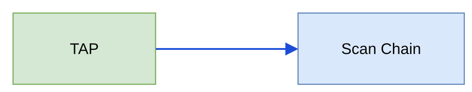 |

`05-terminal-hook.drawio`：3 findings（含 R14 error）→ 0。R14 是硬错误，修不掉要让整次运行失败，不能降级成警告。

**⑧ 舍直取弯的大绕行 — R01**

| before | after |
|---|---|
| 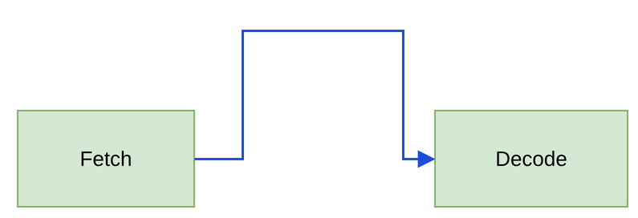 | 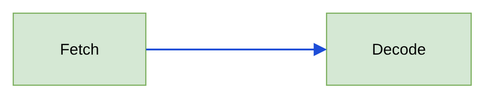 |

`06-long-detour.drawio`：R01 报告 4 个折点，连线 310 px（直线只要 150 px）→ 0。

> 这 6 组用的是 `--layout preserve`：节点几何和连线拓扑不变，只重算锚点、折点、标签。大图上更保守的 `--repair-only` 连全局重布线都不做，只修端点/台阶/bus 间距/标签，越界即整批回滚。

```bash
# 各组一起跑，逐组看报告
for f in assets/examples/symptoms/*.drawio; do
  python3 scripts/optimize.py --input "$f" \
    --out-dir "out/$(basename "$f" .drawio)" --layout preserve
done
```

### 文字与版式

**⑨ 长中文标签溢出 → 节点自动撑高 — L04**

| before | after |
|---|---|
| 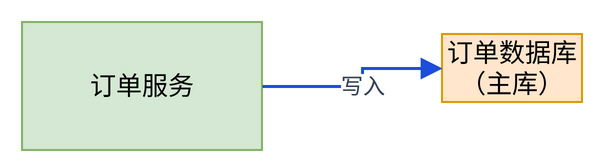 | 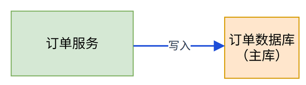 |

`07-text-overflow.drawio`：L04 error + R01 warning → 0。文字用真实 CJK 字体度量（不是按字符数估），节点按实测宽高长大，不会压字也不会瞎撑。

### 检测与验证

**⑩ 报告能看懂，渲染能做证 — 不是「看起来没问题」**

`drc-report.md` 的抬头（来自上面第 ⑨ 组的真实运行）：

```
Result: PASS
Nodes 2 (+0 containers) · edges 1 · violations before 2 → after 0 · auto-fixed 2
Direction LR · preset balanced · layout preserve
```

同一个 run 里，draw.io 导出的 SVG 会被逐条反解、和模型比对：

```json
"svg_check": {
  "verified": true,
  "edges_matched": 1,
  "diagonal_segments": 0,
  "endpoint_errors": { "e1": 2.24 },
  "bend_mismatches": {},
  "issues": []
}
```

- `drc.violations_before` / `violations_after`：每条命中的规则、对象 id、坐标、证据。
- `input.options.wire_changes` / `label_changes` / `node_changes`：每一处改动的 before/after。
- `unfixed_*` 与 `limitations`：没修掉的、没验证的，逐条列出，不会被悄悄吞掉。

### 内置模板


*`assets/templates/soc_dft.yaml` — 8 节点 / 10 边、两个容器、控制/数据/时钟三类线型（即页面顶部首图）。*

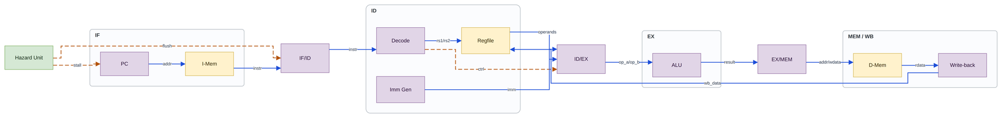

*`assets/templates/rtl_datapath.yaml` — 12 节点 / 14 边，IF / ID / EX / MEM-WB 四个阶段。*

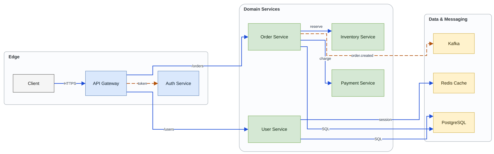

*`assets/templates/microservices.yaml` — 10 节点 / 10 边，网关、领域服务、数据与消息三块。*

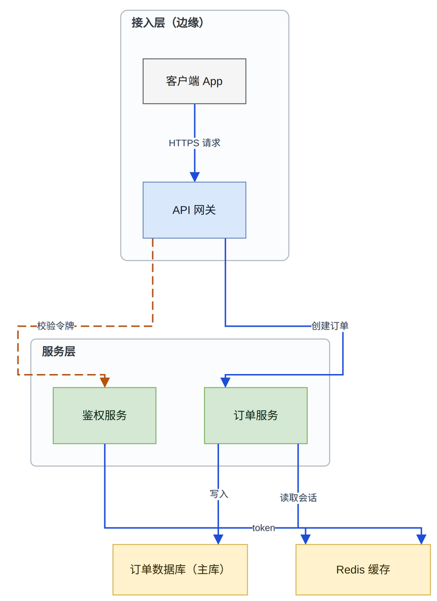

*`assets/examples/cjk_tb.yaml` — 中文标签用真实字体度量排版；跨容器下行线在容器标题带处仍有一段绕行（报告记为 `R11 info: 410px vs 160px direct`），属已知限制，不是静默忽略的缺陷。*

另有 `assets/templates/cpu_block.yaml` 与 `api_flow.yaml` 可直接跑。

---

## 5. 命令参考

| 命令 | 作用 |
|---|---|
| `doctor` | 检查 Python / Pillow / PyYAML / draw.io 与可用能力 |
| `generate` | `--spec` 或 `--text` 生成图并跑完整流水线 |
| `optimize` | 修复/优化已有 `.drawio`（也接受 spec） |
| `analyze` | 输出结构、端口、拥塞、标签统计与当前 DRC（`--json`） |
| `drc` | 只检查不修改，写 `drc-report.json/md`；`--svg` 可校验渲染路径 |
| `layout` | 只重排，不重布线 |
| `route` | 只重新分配端口并重布线 |
| `render` | 导出 PNG/SVG，并对 SVG 做渲染路径校验 |
| `validate` | 解析→写出→再解析 + id 保持 +（可选）再导出 |
| `selftest` | 运行内置测试套件（50 项，无需 pytest） |

常用选项：

| 选项 | 说明 | 默认 |
|---|---|---|
| `--layout full\|preserve\|hybrid` | 节点能否移动 | `.drawio` 输入为 `preserve` |
| `--repair-only` | 最小修复：不重排、不重布线 | 关 |
| `--preset compact\|balanced\|clean-routing` | 评分权重档 | `balanced` |
| `--direction auto\|LR\|RL\|TB\|BT` | 流向与端口约定 | `auto` |
| `--iterations N` | 修复/评分迭代上限 | `3` |
| `--clearance N` / `--min-clearance N` | 布线通道宽度 / DRC 阈值 | `14` / `8` |
| `--no-drawio` | 只用内置预览渲染 | 关 |

---

## 6. 最小修复模式的安全边界

`--repair-only` 是给「已经画好、只是有瑕疵」的大图准备的。它**不跑布局、不跑端口分配、不做全局重布线**，只允许：

| 步骤 | 允许的动作 |
|---|---|
| 端点回溯 | 去掉越过锚点的回头段，保留 18 px 垂直箭尾 |
| 短狗腿 | 入线主干与目标锚点错位 4–40 px 时，吸附目标 `entryX/entryY` 到主干 |
| 回头钩（R14） | 整段末梢移到干净的箭尾通道，折叠 <4 px 碎步 |
| 源端台阶 / Z 形 | 吸附源或目标锚点到主干（Z 位移 ≤220 px） |
| 密集竖排 bus | 统一 36 px 间距；装饰性数字徽标 + 相邻标题条最多平移 120 px（宽度按需收窄以留在容器内），单独记录 |
| 标签碰撞 | 沿自身连线 ≤300 px、横向 ≤36 px 找空位 |

安全保证（代码与测试双重约束）：

- 拓扑签名（边 id / source / target / label / signal）必须不变；
- 功能节点的几何与 id 必须不变（唯一例外是上面记录在案的装饰性位移）；
- 节点/边样式字符串保持原样，只改被明确修复的锚点分数；
- 标签移动不能严格减少碰撞就回滚；吸附若新增 R04 间距违规就回滚；
- 每个改动都写入 `input.options.wire_changes` / `label_changes` / `node_changes`；
- 修不掉的项进 `unfixed_doglegs` / `unfixed_bundle` / `unfixed_labels`，**不会被悄悄降级成通过**。

---

## 7. 质量契约（本工具的设计前提）

优先级从高到低，低优先级不得损害高优先级：

**正确性 → 可读性 → 几何 → 一致性 → 美观**

由此派生出的不可协商条款：

1. **拓扑固定**：不删边、不合并网络、不改 `source`/`target`、不为了排版把反向边掰正。
2. **终段垂直不变量**：连线必须以垂直短桩进入目标边；`R12`/`R14` 是硬错误，修不掉就判定失败。
3. **语义高于几何**：命名引脚、固定端口、容器边界含义、实现/可选/示意状态不能由坐标反推，也不能因为「这样画更短」而改掉。
4. **不接受分数换正确性**：加权分只是启发式；任何引入新硬错误或降低更高优先级的改动一律回滚。
5. **诚实报告**：`summary.passed` 只代表**本次范围内的自动检查**通过，不等于工程验收。自动结果、视觉评审、语义确认必须分开陈述；没做真实渲染就明说没做。

---

## 8. 视觉风格（可选）

内置引擎调色板（interface/controller/memory/datapath/clock… + data/control/clock/bus/power 线型）只是默认值。仓库同时提供一个完整的**个人风格 profile**（`references/t65-reference-style.md` + `t65-style-tokens.json`）：系统级浅色外框、深蓝标题条、中层浅色标题带、扁平矩形、`Noto Sans CJK SC` 可编辑文字。它以独立的「风格 pass」执行，和几何修复分开记录；不需要风格统一时可完全忽略。

---

## 9. 目录结构

```
drawio-optimize/
├── SKILL.md                    # Agent 技能入口（frontmatter + 工作流）
├── README.md
├── LICENSE                     # Apache-2.0
├── agents/openai.yaml          # 技能展示信息
├── assets/
│   ├── templates/*.yaml        # soc_dft / cpu_block / rtl_datapath / api_flow / microservices
│   └── examples/               # 中文 TB 示例、micro_pipeline.yaml、7 组演示图（symptoms/）
├── docs/img/                   # README 配图
├── references/                 # 规则与决策依据（设计原则、变更契约、R/P/L 规则、格式、评分）
├── scripts/
│   ├── {doctor,generate,optimize,analyze,drc,layout,route,render,validate,selftest,selfcheck}.py
│   └── drawio_optimize/        # 实现：layout / ports / router / drc / repair / svgcheck / pipeline …
└── tests/                      # 50 个 unittest 用例
```

主要模块：

| 模块 | 职责 |
|---|---|
| `drawio_io.py` | 压缩页、`UserObject` 包装、锚点/相对坐标的读写与保真 |
| `layout.py` | 分层布局与容器递归 |
| `ports.py` | 端口侧选择、排序、直连吸附 |
| `router.py` | 直连/单折 → A* → rip-up → 微折点清理 |
| `drc.py` | 33 条规则与自动修复 |
| `repair.py` | 最小修复模式（端点、台阶、bus lane、标签） |
| `svgcheck.py` | 渲染 SVG 的逐边路径校验（含跳线弧、双向箭头） |
| `pipeline.py` | 迭代、评分、回滚、产物写出 |

---

## 10. 作为 AI Agent Skill 安装

本仓库同时是一个 agent skill：`SKILL.md` 的 frontmatter 是入口，`references/` 是给模型的决策依据。

```bash
git clone <repo-url> drawio-optimize
cp -r drawio-optimize ~/.codex/skills/     # 或 ~/.claude/skills/、其他 agent 的 skills 目录
python3 ~/.codex/skills/drawio-optimize/scripts/doctor.py
```

之后在对话里直接说「用 drawio-optimize 修这张图」即可；模型会读 `SKILL.md`，按 **Detect → Diagnose → Plan → Fix → Render → Validate** 执行，并在交付时分别给出自动几何结果、视觉评审和未决语义。

---

## 11. 开发与测试

```bash
python3 scripts/selfcheck.py       # 50 tests, stdlib unittest，逐条打印
python3 scripts/selftest.py        # 同一套，走 CLI 子命令（-v 更详细）
python3 scripts/validate.py --input out/diagram.drawio
```

```bash
# 一次真实回归：生成全部模板（每个都应为 PASS 且 unfixed errors 0）
for t in soc_dft cpu_block rtl_datapath api_flow microservices; do
  python3 scripts/generate.py --spec assets/templates/$t.yaml --out-dir /tmp/t-$t
done
```

实测结果：5 个模板全部 `PASS`、`unfixed errors 0`；剩余仅为交叉、并行线间距等 warning（密集框图里属于设计取舍，报告会逐条列出）。

新增 DRC 规则时，规则需同时登记到注册表与文档；`tests/test_rules_registry.py` 会校验 `R01–R14`、`P01–P10`、`L01–L07` 全部存在且元数据完整。

---

## 12. 已知限制（不隐藏）

- 文本用真实字体度量 + 6% 安全余量，但浏览器换行仍可能与测量有细微差异，超长标签尤其如此。
- 容器只是视觉分组：边可以穿过容器主体（报为 info），但不能压标题带；容器内部**不是**独立布线平面。
- `preserve` 模式无法在不移动任何东西的前提下消除节点重叠或间距不均，只会如实报告；需要微调请用 `--layout hybrid`。
- `--repair-only` 故意不消灭所有警告：紧贴的模块间距、刻意保留的交叉、没有空位的标签会留在报告里——要修就得挪模块或重写布局，超出该模式的授权范围。
- 渲染路径 DRC 只检查连线；标签几何来自字体度量，因为 draw.io 把标签输出成 HTML `foreignObject`。
- 规格里的 `weights:`、`constraints.h_gap/v_gap` 当前 CLI **不会**传递到流水线，别指望它们生效。
- 自动检查通过 ≠ 工程验收：语义、层级、最终显示尺寸下的可读性需要人工/Agent 复核。

---

## 13. 许可证

[Apache License 2.0](LICENSE)，Copyright 2026 pengfaming。

已附带 `.gitignore`（忽略 `__pycache__/`、`out/`、`pnr-out/`、`render/` 等生成物），可直接初始化仓库：

```bash
git init
git add .
git commit -m "init: drawio-optimize v1.3.0"
git branch -M main
git remote add origin <github-or-gitee-url>
git push -u origin main
```

需要的话，我可以补 `LICENSE`、GitHub Actions（`python3 scripts/selfcheck.py`）和 Gitee 发布说明。
